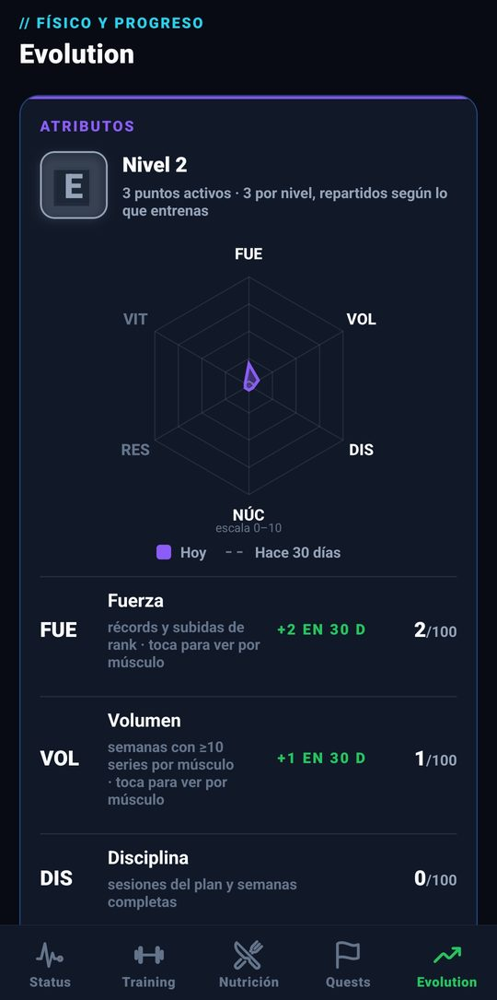
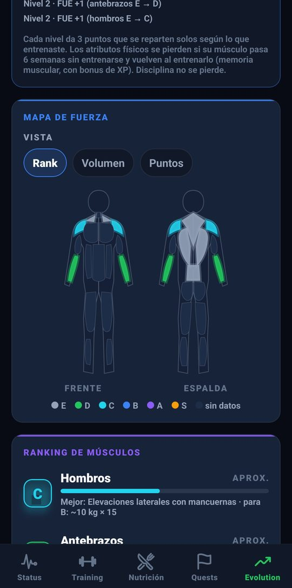
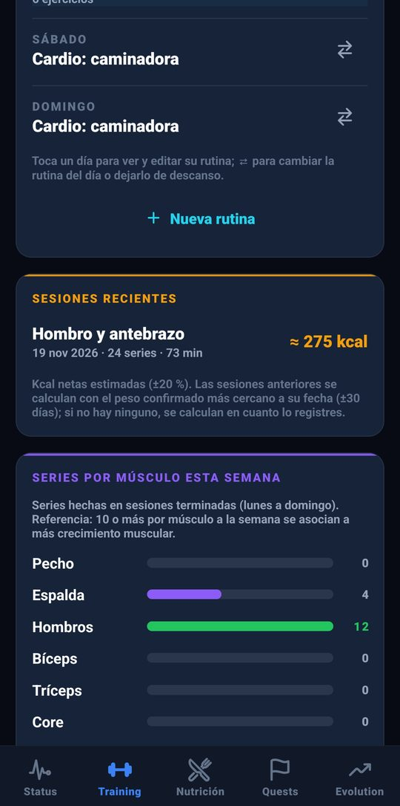
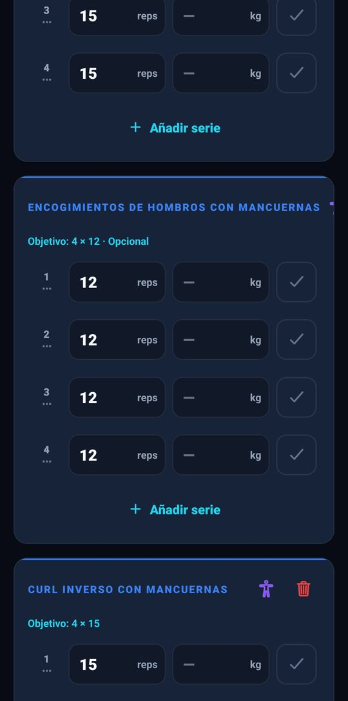
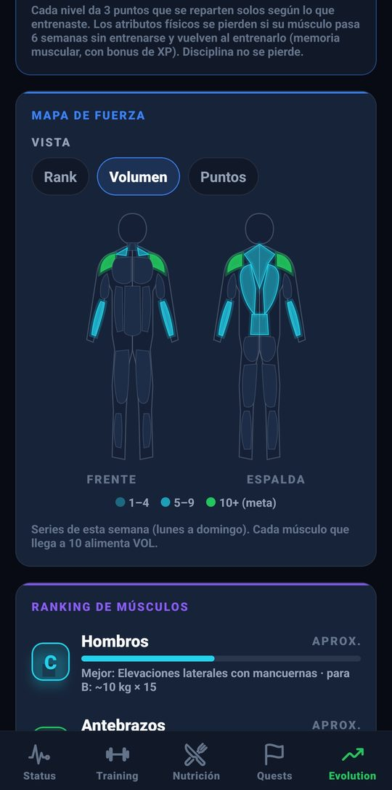
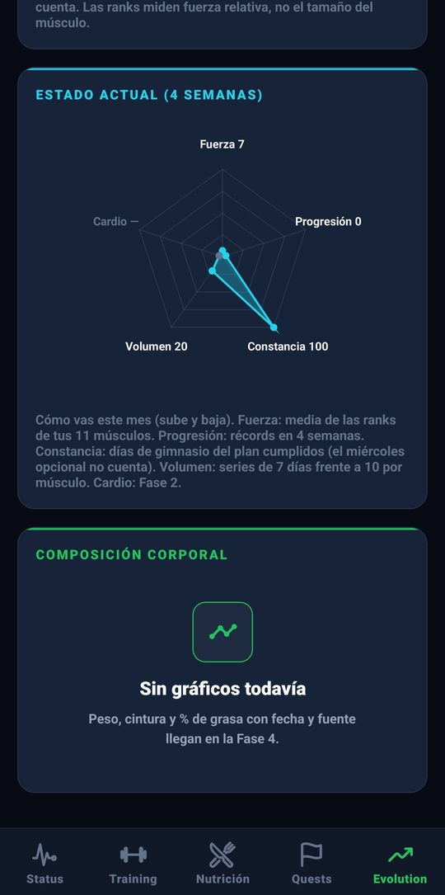
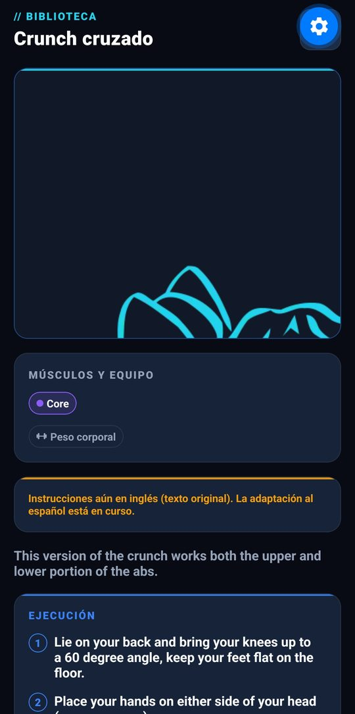

# PROJECT ASCENSION

App Android de entrenamiento con progresión RPG. Registras tus series y tu caminadora; la app te sube de nivel, reparte
puntos de atributo, calcula un rank de fuerza por músculo y te pone a prueba con exámenes de rango. Todo es local:
funciona sin conexión y los datos se quedan en el teléfono.

> Proyecto personal de [Joel Medina Morales](https://github.com/jjmmcode), en desarrollo activo.

<p>
  
  
  
  
</p>
<p>
  
  
  
</p>

## Qué hace

**Entrenamiento**

- Plan semanal editable (rutinas por día, miércoles opcional) y sesión en vivo: series precargadas con tu objetivo y el
  peso de la última vez.
- Sugerencia de progresión doble: cuando completas todas las series en el tope del rango, propone subir carga (+5 % o el
  salto del equipo: 2 kg en mancuernas, 5 kg en máquinas de placas, 2,5 kg en el resto; menos asistencia en ejercicios
  asistidos).
- Temporizador de descanso automático (120 s compuestos, 90 s aislamiento, 60 s series por tiempo) que sobrevive a que la
  app pase a segundo plano.
- Biblioteca de ejercicios con técnica, músculos y mapa corporal.
- Kcal netas estimadas de cada sesión de pesas (Compendio de Actividad Física 2024) y de la caminadora (ecuaciones del ACSM),
  con una línea lista para copiar en Fitia.

**Progresión RPG**

- XP idempotente con topes diarios (no premia entrenar de más) y curva `45 · nivel^1,1` (nivel 100 ≈ 10 años de constancia).
- Rangos generales E → SSS+ con examen de rango (cada rango pide músculos de su misma letra; SSS+ = los 11 en élite); rank E–S por músculo según tu fuerza relativa (1RM estimado ÷ peso).
- Atributos estilo Xenoverse (FUE, VOL, DIS, NÚC, RES, VIT): 3 puntos por nivel que se reparten solos según lo que
  hiciste. Si dejas de entrenar un músculo 6 semanas, sus puntos se pierden y vuelven al retomarlo (memoria muscular).
- Penitencia por inactividad: aviso a los 5 días; al 7.º, misión de 2 sesiones en 7 días. Si la fallas pierdes la XP del
  nivel y después niveles. El rango no se pierde, pero su emblema se agrieta, se fractura o se destroza hasta que
  recuperas el nivel, con XP doble mientras tanto. Modo descanso de hasta 14 días para enfermedad, lesión o viaje.
- Misión secundaria semanal sobre tu músculo más débil.
- Sonidos (CC0) que se mezclan con tu música sin pausarla y respetan el modo silencio.

**Datos**

- SQLite local con migraciones versionadas. Copia de seguridad en JSON (exportar con el menú de compartir del sistema y
  restaurar todo o nada).

## Ejecutarlo

Requisitos: Node.js 22.13 o superior (las pruebas usan el SQLite integrado de Node) y un teléfono Android.

```bash
git clone https://github.com/jjmmcode/project-ascension.git
cd project-ascension
npm ci
npx tsc --noEmit      # tipos
npx jest              # pruebas (lógica y base de datos)
npx expo start        # servidor de desarrollo
```

La app usa módulos nativos (SQLite, audio, archivos), así que necesitas un *development build* en lugar de Expo Go:

```bash
npx expo run:android                              # con Android Studio y un teléfono conectado
# o en la nube:
npx eas-cli@latest build -p android --profile development
```

### APK automático

Cada push a `main` o a una rama `feat/**` ejecuta `.github/workflows/android-apk.yml`: tipos, pruebas, `expo prebuild` y
`gradlew assembleRelease`. El APK queda en **Releases** (`APK <rama>`) y se instala encima del anterior sin perder datos.

## Cómo está hecho

| Capa | Tecnología |
|---|---|
| App | React Native + Expo SDK 58, TypeScript estricto, Expo Router |
| Estado | Zustand (caché en memoria; SQLite es la fuente de verdad) |
| Datos | expo-sqlite, migraciones v1–v7, transacciones anidables con SAVEPOINT, validación con Zod |
| Animación | Reanimated + react-native-svg |
| Audio | expo-audio |
| Pruebas | Jest contra SQLite real (`node:sqlite`) |

```
src/app/          pantallas (Expo Router)
src/components/   UI reutilizable y componentes de juego
src/features/     lógica pura por módulo (progression, physique, attributes, penance, cardio, training, sound…)
src/services/     casos de uso sobre la base de datos (XP, sesiones, penitencia, cardio, copia de seguridad…)
src/database/     cliente, migraciones y repositorios
tests/            pruebas unitarias y de integración
docs/             diseño de cada sistema
```

La lógica de juego es pura y determinista (se recalcula desde el historial), y la interfaz solo la muestra. Más detalle:

- [Arquitectura](docs/ARCHITECTURE.md) · [Modelo de datos](docs/DATA_MODEL.md)
- [Sistema RPG](docs/RPG_SYSTEM.md) · [Físico, ranks y atributos](docs/PHYSIQUE.md)
- [Penitencia, emblema roto y sonidos](docs/PENANCE.md) · [Caminadora](docs/CARDIO.md) · [Gasto energético](docs/ENERGY.md)
- [Plan semanal](docs/TRAINING_PLAN.md) · [Hoja de ruta](docs/ROADMAP.md)

## Créditos

- Ilustraciones y descripciones base de ejercicios: [Everkinetic](https://github.com/everkinetic/data), CC BY-SA 4.0.
- Sonidos: [Kenney](https://kenney.nl) «Interface Sounds» y «Music Jingles», CC0 1.0 (`assets/sounds/`).
- Fórmulas: Compendio de Actividad Física 2024 y ecuaciones metabólicas del ACSM.

La app no reemplaza a un profesional de la salud: es una guía de entrenamiento y sus kcal son estimaciones.

## Licencia

Código © 2026 Joel Medina Morales, todos los derechos reservados (ver [LICENSE](LICENSE)). Los recursos de terceros
mantienen sus licencias.
